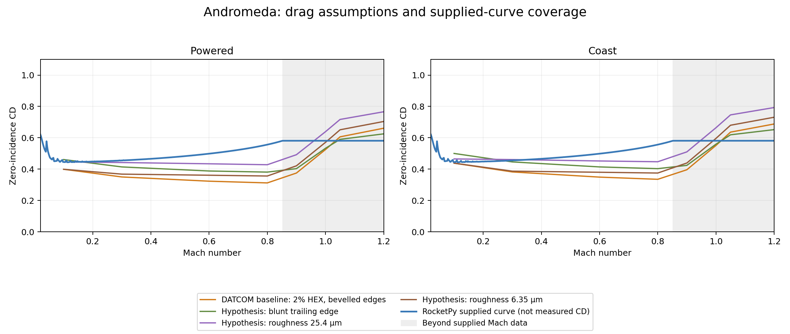

# Why Andromeda's DATCOM CD differs

**A flight-configuration mismatch was found:** ASAT's
[2022 launch report](https://asat.gr/asat-launches-twice-and-takes-7th-place-in-the-european-rocketry-challenge-2022-euroc/)
says both EuRoC launches used airbrakes. Neither the source RocketPy notebook
nor our DATCOM model contains an airbrake deployment model. This is a concrete
reason the bare-vehicle simulation can overpredict the flown apogee. The report
does not supply a deployment log, brake geometry or drag map, so the size of
that contribution cannot yet be established. It also reports the COTS apogee
as 3446 m, versus the notebook's 3443 m; the 3 m reference discrepancy is retained
as a source disagreement, not used to change the comparison target.

ASAT's [automatic-control description](https://asat.gr/automatic-control/)
explains that the vehicle is designed to overshoot the target without brakes,
and the controller deploys surfaces to increase drag. Its
[aerodynamics description](https://asat.gr/aerodynamics/) confirms that
Andromeda's proposed boattail was not used, consistent with the notebook.
These primary team pages were checked on 2026-11-06. They do not identify
the supplied CSV as a particular CFD, OpenRocket or wind-tunnel product.

The supplied zero-incidence drag curve explains almost the entire difference
between the two model apogees. A diagnostic that replaces only DATCOM's
zero-incidence axial-force curve by the supplied RocketPy curve gives
**3615.05 m**, versus **3615.88 m** for ordinary RocketPy and **4170.73 m**
for native DATCOM. The recorded apogee is **3443 m**.
DATCOM's remaining incidence increments, lateral coefficients, static moments,
damping, mass, motor, launch and atmosphere inputs remain in the diagnostic.
This isolates the model discrepancy; it does not establish which CD is correct.

No parser or geometry-conversion fault was found in the checks below. The
relative contributions of the unmodeled airbrakes, fin section, surface finish
and supplied-curve assumptions remain underdetermined. Fitting a roughness to
the flown apogee could absorb missing brake drag and would not identify a
physical surface finish.

## CD and its components

At Mach 0.6, alpha = beta = 0 degrees:

| Quantity | Powered | Coast |
| --- | ---: | ---: |
| Supplied RocketPy CD | 0.49850 | 0.49850 |
| Native DATCOM CD | 0.323 | 0.349 |
| DATCOM difference relative to supplied CD | -35.2% | -30.0% |
| Body skin friction | 0.1549 | 0.1599 |
| Body pressure/wave drag | 0.0106 | 0.0109 |
| Body base drag | 0.1171 | 0.1360 |
| All three fins | 0.0407 | 0.0422 |

The printed components reproduce native totals to their output precision.
**Coast base drag is included, all three fins contribute, and CD equals CA
at zero incidence.** The frontal reference area is 0.0178367771 m², matching
RocketPy's radius of 0.07535 m. The translated geometry is a 2.4996 m body
with a 0.3 m von Karman nose and three fins: 0.23/0.11 m root/tip chords,
0.185 m exposed span, 0.12 m leading-edge sweep, leading-edge stations
2.145/2.265 m aft of the nose. `SSPAN(1)=0` correctly requests automatic
body attachment, per manual section 3.1.6.

DATCOM's default boundary layer is **fully turbulent**, with **zero roughness**;
the low drag is not due to a laminar-boundary-layer setting. Carbon fibre with
vinyl describes construction but does not establish a numerical roughness.
The assumed 2%-thick HEX section tapers from **4.6 mm at the root to 2.2 mm
at the tip**, with sharp edges and 5%-chord bevels. These are unverified inputs.

## Controlled sensitivity runs

All runs retain the saved Mach/alpha/beta grids and phase-dependent Reynolds
schedules for the trajectories. There is no apogee fitting or CD multiplier.
The coefficient probes use eight Mach values with alpha -2/0/2 degrees and
beta zero. Other inputs retain the saved geometry and interpolated Reynolds
schedules; they are diagnostic tables, not the complete original flight decks.

| Input hypothesis | Coast CD at Mach 0.6 | Apogee AGL (m) | Recorded-reference error |
| --- | ---: | ---: | ---: |
| Baseline: smooth, 2% HEX, sharp ends | 0.349 | 4170.73 | +21.14% |
| Blunt trailing edge, USER section | 0.414 | 3973.73 | +15.41% |
| Roughness 6.35 µm, original HEX section | 0.380 | 4021.98 | +16.82% |
| Roughness 25.4 µm, original HEX section | 0.452 | 3763.00 | +9.29% |

A 4 mm constant-thickness plate with 5 mm bevels gives CD 0.350 at Mach 0.6;
doubling HEX thickness/chord to 4% gives 0.351. Thickness alone therefore
does not close the subsonic CD gap. It has a larger effect near Mach 1.
A 100 µm roughness coefficient probe gives coast CD 0.558 at Mach 0.6, showing
that roughness can numerically bracket the supplied curve; this is not evidence
that the actual rocket has that finish. No such finish is adopted or fitted.

The 6.35 µm value is the manual Table 2 example for carefully applied smooth
matte paint, **not a prescribed value for vinyl**. The 25.4 and 100 µm values
are broader sensitivity hypotheses. The USER blunt-edge probe uses the same
normalized section along the span, so it also tapers in physical thickness.
The guide warns that non-sharp trailing edges and exceeded crest-critical
Mach use approximate airfoil properties (section 4.2.2). This executable also
returns identical coefficients for the blunt-trailing-edge and square-at-both-
ends USER hypotheses; that does not establish equal physical drag.

## Powered versus coast contribution

| Diagnostic | Apogee AGL (m) |
| --- | ---: |
| Ordinary RocketPy, supplied powered/coast CD | 3615.88 |
| Native DATCOM throughout | 4170.73 |
| Replace only powered zero-incidence CD | 4069.04 |
| Replace only coast zero-incidence CD | 3715.58 |
| Replace both zero-incidence CD curves | 3615.05 |

Coast drag accounts for the larger share of this difference. The two effects
are not additive because changing powered drag changes the coast initial state.
The substitutions are explicitly diagnostic and are not native DATCOM results.

## Limitations of the supplied curve

The source CSV contains 534 rows, with Mach increasing to **0.85204** and then
mostly decreasing. It is not a monotonic zero-incidence sweep. RocketPy sorts
the Mach samples and uses linear interpolation; the rising/falling branches
differ by at most about 0.0016 CD between Mach 0.2 and 0.8, which cannot explain
the roughly 0.15 coast-CD discrepancy at Mach 0.6.

There are **no supplied points above Mach 0.85204**. RocketPy holds CD at the
last supported value, **0.58102**, through its simulated peak near Mach 1.005.
The same file is supplied for both powered and coast drag. Neither the CSV nor
its notebook establishes CFD, wind-tunnel or other provenance, reference area,
Reynolds conditions, incidence or surface finish. The original
[Andromeda example PR](https://github.com/RocketPy-Team/RocketPy/pull/754)
also explicitly describes its inputs as less rigorous than other examples.
The supplied curve is a useful model input, not established measured CD.

## Inspect or reproduce



- [Powered DATCOM input](rockets/andromeda_audit_powered_for005.dat) and
  [native output](rockets/andromeda_audit_powered_for006.dat).
- [Coast DATCOM input](rockets/andromeda_audit_coast_for005.dat) and
  [native output](rockets/andromeda_audit_coast_for006.dat).
- [Component breakdown](andromeda_drag_breakdown.csv),
  [coefficient probes](andromeda_drag_audit_curves.csv),
  [trajectory diagnostics](andromeda_drag_audit_flights.csv) and
  [metadata and native warnings](andromeda_drag_audit.json).

The retained native listings have trailing blanks removed. The reference is
the local *Missile DATCOM Users Guide*, revision 5/97, Tables 2, 4 and 5 and
sections 3.1.6 and 4.2.2; the executable identifies itself as revision 3/99.
Original notebook data, comparison baselines and production equations are
unchanged; comparison metadata now flags the reported airbrakes. Brake geometry,
deployment history, hardware section/finish measurements and the supplied
curve's provenance are needed before choosing a physical correction.

```sh
python docs/examples/datcom/comparison_data/audit_andromeda_drag.py
```
